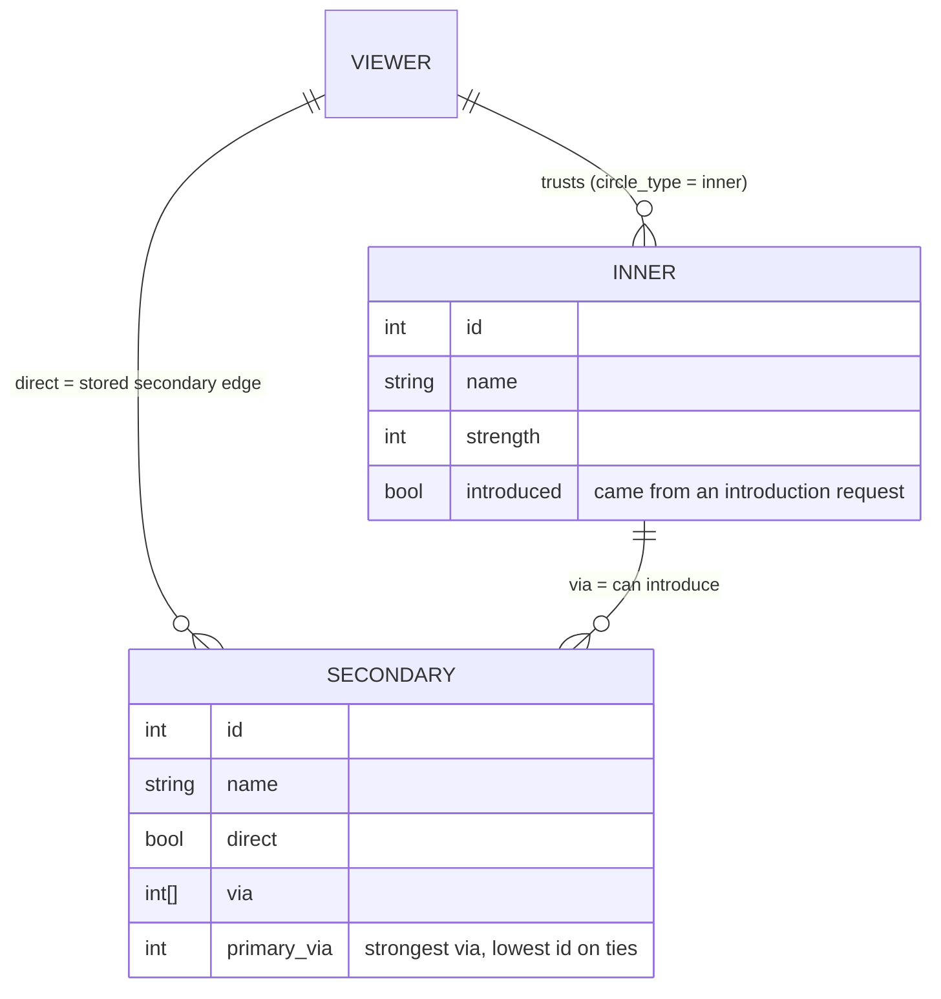
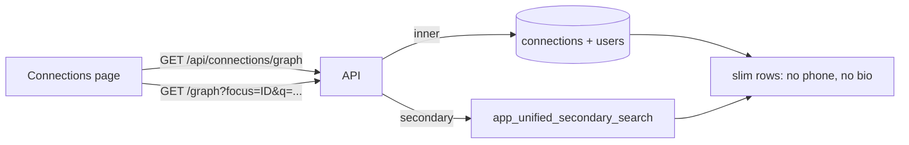
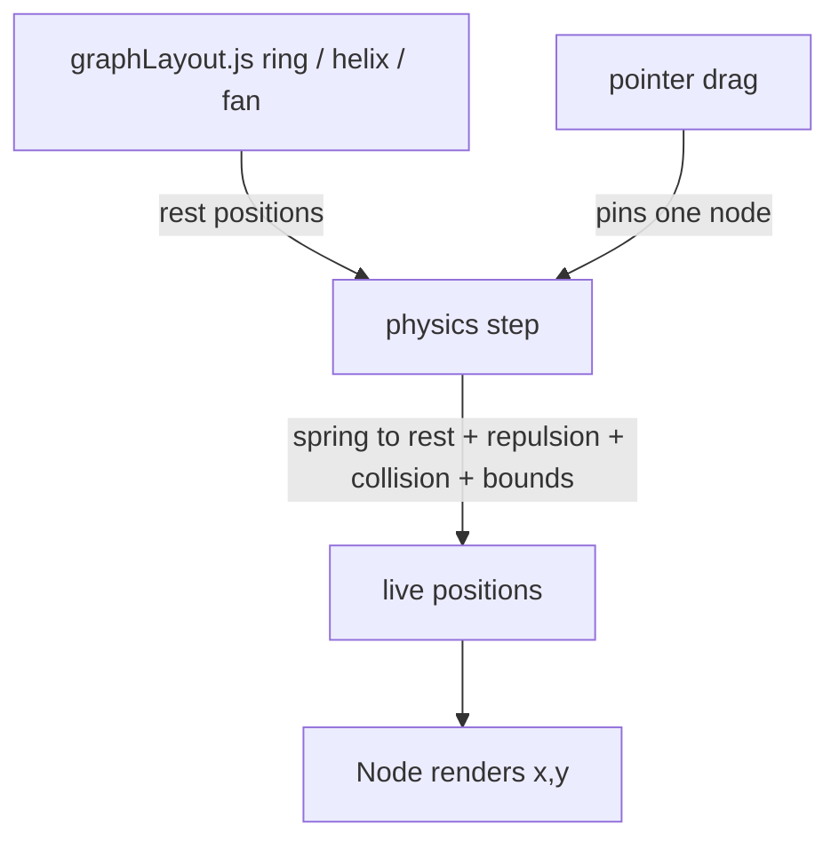
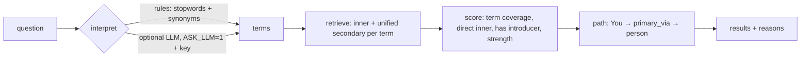

# Connections graph — next round (roadmap)

**Status:** Approved for implementation (2026-10-30: user chose all four directions).

Four pieces of work, built in this order because each leans on the one before:

| # | Piece | Plan | Depends on |
|---|-------|------|-----------|
| A | API contract cleanup (`GET /api/connections/graph`) | [`plans/2026-10-30-graph-api-contract.md`](../plans/2026-10-30-graph-api-contract.md) | none |
| B | Immersive layout on desktop | [`plans/2026-10-30-immersive-desktop.md`](../plans/2026-10-30-immersive-desktop.md) | none (uses the modal overlay work already merged) |
| C | Free-form (force-directed) layout | [`plans/2026-10-30-free-form-layout.md`](../plans/2026-10-30-free-form-layout.md) | B for desktop drag |
| D | Ask-your-network search | [`plans/2026-10-30-ask-your-network.md`](../plans/2026-10-30-ask-your-network.md) | A (`via`, `primary_via`, slim rows) |

## What the review found (why A comes first)

1. **"Secondary" means two things.** A stored edge with `circle_type='secondary'` (the viewer's own link), and a person *discovered* through an inner peer (`app_unified_secondary_search`). Most demo secondaries are both; some are edge-only with no introducer.
2. **A secondary can sit behind several inner peers** (`via_inner_peer_ids`), but the graph draws a tree. Which branch the person belongs to is a rendering choice nobody has written down.
3. **`peer_introduced` is reused to mean "has a direct edge"** for secondaries (`Connections.js`, `normalizeGraphNode`), while for inner peers it means "introduced via a request". Same field name, two meanings.
4. **The introduction rule is duplicated in the frontend** (`secondaryIntroEligibleViaFocusedInner` mirrors the SQL `app_can_intermediate`), so the UI and database can drift.
5. **Three response shapes** for one idea: `/connections` (`connections[].peer_*`), `/secondary-for/:id` (`secondaryConnections[]`), `/secondary-search` (`results[]`).
6. **Graph rows carry `peer_phone` and `peer_experience`** (bio text) though the graph shows neither.

## Data model the graph will consume



Rules the API will state explicitly:

- `direct` = the viewer has a stored secondary edge to this person.
- `via` = inner peers who can introduce the viewer (the discovery paths). **A person can be introduced only if `via` is non-empty.**
- `primary_via` = the single branch used to place the person in the tree: highest inner `strength`, ties by lowest id; `null` when `via` is empty.
- `introduced` (inner only) = the inner link was created by an introduction request.

## Request flow after A



## Desktop immersive (B) — layout intent

```
 desktop, 1280 wide                      phone, 375 wide (today)
┌────────────────────────────────┐      ┌───────────────┐
│ Intro                  Sign out│      │ Intro         │
├────────────────────────────────┤      │ hero line     │
│           hero line            │      │   ( graph )   │
│        ┌────────────┐          │      │               │
│        │   graph    │          │      │  stats dock   │
│        │  (square,  │          │      │ [Search][Det.]│
│        │ max 760px) │          │      │  bottom nav   │
│        └────────────┘          │      └───────────────┘
│        stats dock (max 560)    │
│        [Search] [Details]      │
│            bottom nav          │
└────────────────────────────────┘
```

## Free-form layout (C) — how forces relate to today's layout



Rest positions stay the source of truth (and the thing tests assert); physics only moves nodes *around* them, so turning the flag off restores today's behavior exactly.

## Ask-your-network (D) — pipeline



Default is **rules-only** (no key, no network). The optional model call only improves interpretation; retrieval, scoring and authorization stay in SQL/Node so the model never sees people data.

## Decisions

| Topic | Choice |
|--------|--------|
| API versioning | **Additive**: new `/api/connections/graph`; old endpoints untouched (Contacts and the radial dial still use them) |
| SQL | **No migration** — response shaping only, so Compose mounts, `testDb.js` order and `verify:migrations` are unaffected |
| Physics | **Hand-rolled, no dependency**: pure `stepPhysics`, deterministic, unit-testable |
| Free-form default | **Off** (flag); persisted per user in `localStorage` |
| Ask mode | **Rules by default**, LLM optional via env, never required |
| Commits | Not made until requested |

## Out of scope

- Embeddings / pgvector (not installed locally; FTS covers the demo scale).
- Removing `peer_phone` from `/api/connections` (Contacts needs it).
- Admin tooling and tenant theming payloads.
